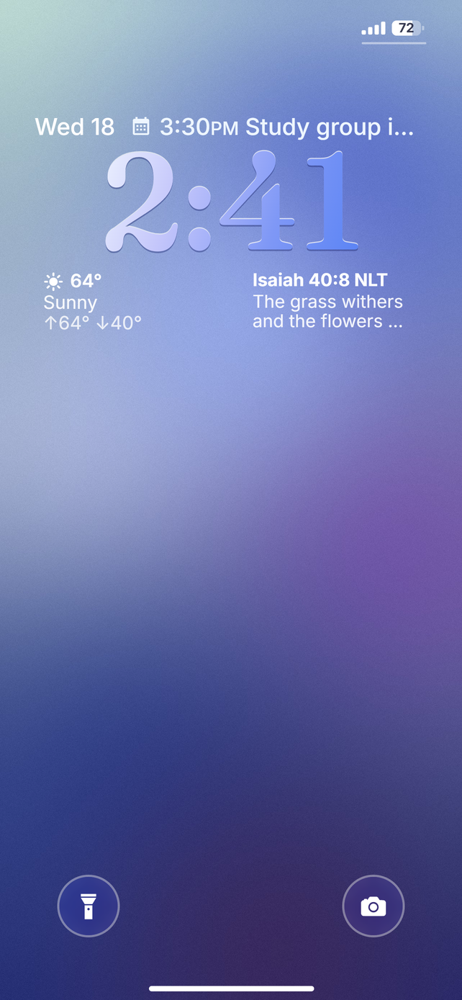
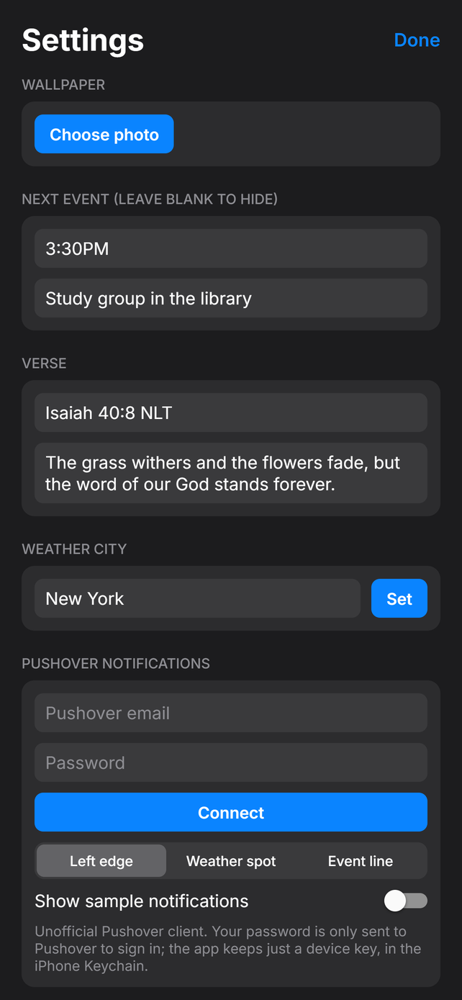
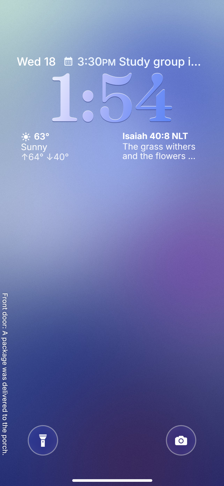
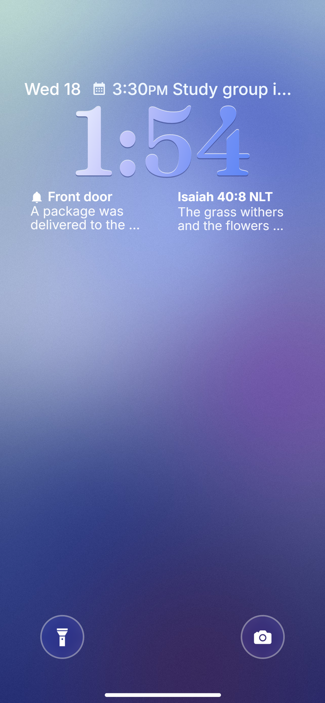
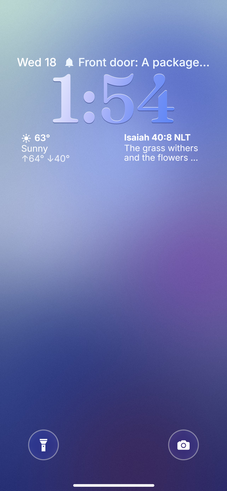
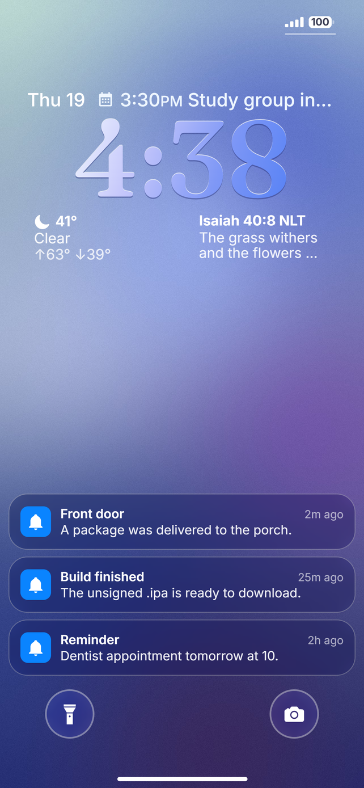

# Lock Screen

An iOS-style lock screen as an Expo (React Native + TypeScript) app:

- your own wallpaper photo
- the date and next calendar event
- a big live glassy clock
- live weather for your city and a Bible verse widget
- a status bar with live battery and Wi-Fi
- flashlight and camera buttons
- Pushover notifications, shown up the left edge, in the weather widget's spot, in the top line, or as an iOS-style list

Everything personal is set on the phone, in Settings, and stays there.

| Default look | Settings (long-press) |
| --- | --- |
|  |  |

| Notification: edge | Weather spot | Event spot | List |
| --- | --- | --- | --- |
|  |  |  |  |

You don't need a Mac for any of this.

---

## 1. Run it on your iPhone with Expo Go

This is the fastest way to try the app. Nothing gets installed on the phone except Expo Go.

1. On your PC, install **Node.js LTS** from <https://nodejs.org>.
2. On your iPhone, install **Expo Go** from the App Store.
3. Open a terminal in this folder and run:

   ```sh
   npm install
   npx expo start
   ```

4. A QR code appears in the terminal. Open the iPhone's **Camera** app, point it at the QR code and tap the banner. The app opens in Expo Go.

The PC and the phone must be on the **same Wi-Fi network**. On school or work Wi-Fi, or if the phone can't connect, use a tunnel instead:

```sh
npx expo start --tunnel
```

Save any file and the app on the phone reloads by itself.

### Make it yours: long-press the lock screen

Press and hold anywhere on the lock screen to open **Settings**. There you can:

- **Choose a wallpaper** from your Photos. It's copied into the app's own storage. **Use default** goes back to the built-in gradient.
- Pick a **clock font**: Serif, Bold, Rounded, Thin or Narrow. Bold and Thin use San Francisco, the iPhone's own lock screen font.
- Set the **next event** (time and title). Leave both blank to hide it, and the date then shows the month too ("Wed Nov 18").
- Set the **verse** reference and text.
- Set the **weather city**. Type a name and tap **Set**; it's looked up with Open-Meteo's free geocoder.
- Pick where **Pushover notifications** show, and turn sample notifications on to preview them.
- Show or hide the **status bar** along the top, and type your **carrier name** for it. Battery and Wi-Fi are live. iOS doesn't let apps read the carrier name or signal strength, so you type the carrier yourself and the signal bars always show full.
- Choose how the screen behaves. While the app is open, the iPhone never auto-locks:
  - **Keep screen bright** off (the default): after the **Dim after** time with no touches (15 seconds to 5 minutes), the screen dims like an always-on display. It lowers the real brightness and darkens the picture. A tap, or a new Pushover notification, wakes it. The first tap only wakes the screen, so it can't switch on the flashlight by accident.
  - **Keep screen bright** on: the screen stays at full brightness.

  Either way it's best used on a charger. iPhones with OLED screens can get burn-in if one static image shows for hours every day, and dimming helps with that.

Settings are saved on the phone only, never in the code. The defaults for a fresh install are in `src/config.ts`.

**Turning a lock screen screenshot into a wallpaper.** If your wallpaper only exists as a lock screen screenshot, `scripts/make_wallpaper.py` can erase the clock, widgets and status bar from it. It works on 1284×2778 screenshots and needs `opencv-python` and `numpy`:

```sh
python scripts/make_wallpaper.py screenshot.png wallpaper.jpg
```

Then get `wallpaper.jpg` onto the phone, for example through iCloud Drive, save it to Photos, and pick it in Settings.

---

## 2. Pushover notifications (optional)

The app can show your [Pushover](https://pushover.net) notifications on the lock screen. It is an **unofficial Pushover Open Client**: it registers itself as an extra Pushover "device" and receives messages live over Pushover's WebSocket.

**Pick a spot.** Choose where notifications show in Settings, under *Pushover notifications*. The first three spots borrow one place on the screen for the newest notification. **List** shows all of them:

| Option | Where it shows |
| --- | --- |
| **Edge** | Small sideways text running up the left edge, ending beside the flashlight |
| **Weather** | In place of the weather widget, styled like a widget |
| **Event** | In place of the calendar event in the top line, with a bell icon |
| **List** | Every notification as an iOS-style card, with app icon, title, time and message, stacked above the flashlight and camera buttons, newest on top. The list scrolls when it's longer than the space. |

With **List** selected, Settings also lets you pick the **notification icon**. **App** shows the sending app's Pushover icon; the others are generic: Bell, Message, Mail, Calendar, Home, Alert, Star and Heart. You can also type a **name**. With a name, cards use the older iOS layout: the name in bold, then the notification's title, then the message.

When nothing is pending, the screen looks normal: there's no edge text or list, and the weather and event show as usual. Tap a notification to dismiss it.

**Read aloud.** Under **Read new notifications aloud**, pick:

- **Off**: notifications are never spoken. This is the default.
- **Always**: each new notification ("title. message") is spoken as it arrives.
- **Headphones**: notifications are spoken only while wired or Bluetooth headphones, such as AirPods, are connected. CarPlay doesn't count. A Bluetooth car stereo without CarPlay looks like headphones to iOS, so it does count. This needs the installed app; Expo Go can't detect headphones, so in Expo Go this mode stays quiet.

Speech plays even with the silent switch on, and music keeps playing underneath. Up to three notifications are read at once; a bigger batch ends with "and 5 more notifications". Choosing a mode says a short test line when it's allowed to speak. Only notifications that arrive while the app is open are read.

To preview a spot before setting up Pushover, turn on **Show sample notifications**. That shows three sample notifications.

**Connect your account** in Settings, under *Pushover notifications*:

1. Enter your Pushover email and password, and tap **Connect**.
2. If your account uses two-factor sign-in, a code field appears. Enter the code and tap **Connect** again.

The app registers itself as a new Pushover device named `lockscreen-` plus four random characters. **Disconnect** forgets it.

Things to know:

- **Your password is never stored.** It's sent only to Pushover, once, to sign in. The app keeps only the device key Pushover returns, in the iPhone Keychain. Nothing secret is in the code or in the built .ipa, so the repo and the builds are safe to share.
- **Tap a notification to dismiss it.** Notifications are kept on the phone until you dismiss them, because the app deletes them from Pushover's servers after downloading them, as the Open Client API asks.
- **Deleting the app forgets the sign-in.** After a reinstall, connect again; it registers a fresh device. You can remove old devices at <https://pushover.net>.
- **Pushover licensing:** Pushover counts an Open Client device as a *desktop* device. After 30 days you need the one-time Pushover for Desktop license.
- **On the web preview** the sign-in isn't remembered, because there's no Keychain.

---

## 3. Get an .ipa without a Mac

An .ipa is the installable iPhone app file. Both routes below build an **unsigned** .ipa on Apple hardware in the cloud. AltStore or SideStore then signs it with your free Apple ID when you install it.

The build logic for both routes lives in `scripts/build-unsigned-ipa.sh`.

### Option A: EAS Build (Expo's cloud, free tier)

1. Create a free account at <https://expo.dev/signup>.
2. Log in and link this project. The second command adds a project ID to `app.json`, so commit that change afterwards.

   ```sh
   npx eas-cli login
   npx eas-cli init
   ```

3. Start the build:

   ```sh
   npx eas-cli build --platform ios --profile sideload
   ```

   The `sideload` profile in `eas.json` skips Apple credentials. It runs the custom steps in `.eas/build/unsigned-ios.yml`.

4. Free builds wait in a queue, which can take a while. When the build finishes, open its page on expo.dev and download **LockScreen-unsigned.ipa**. The free plan includes a limited number of iOS builds per month; see <https://expo.dev/pricing>.

### Option B: GitHub Actions (GitHub's macOS machines)

1. Create a repository on GitHub and push this project to it. A public repo is fine: the code and the builds contain nothing personal or secret.
2. Open the **Actions** tab, choose **Unsigned iOS build** and click **Run workflow**. It takes about 15–30 minutes.
3. Open the finished run and download **LockScreen-unsigned-ipa** under *Artifacts*. Unzip it to get the .ipa.

Public repos get macOS build minutes for free. Private repos use your free monthly Actions minutes, and macOS minutes count 10× there.

---

## 4. Install it with AltStore or SideStore (free Apple ID)

### AltStore (Windows PC + USB cable)

1. On the PC, install **iTunes** and **iCloud**. Use the versions from Apple's website, not the Microsoft Store.
2. Install **AltServer** from <https://altstore.io>. Plug in the iPhone and trust the computer.
3. Click the AltServer tray icon, choose **Install AltStore**, pick your phone and sign in with your Apple ID.
4. On the iPhone, trust your Apple ID in **Settings → General → VPN & Device Management**. Then turn on **Settings → Privacy & Security → Developer Mode** and restart when asked.
5. Copy the .ipa to the phone. AirDrop doesn't work from Windows, so use iCloud Drive or email it to yourself and save it to Files.
6. In AltStore, open **My Apps**, tap **+** and pick the .ipa.

### SideStore (no PC after setup)

SideStore is a fork of AltStore that refreshes apps on the phone itself, using a pairing file and a VPN app. Follow the setup guide at <https://sidestore.io>. Then install the .ipa from **My Apps → +**, the same way as in AltStore.

### Free Apple ID limits

- **Apps expire after 7 days.** Before then, open AltStore or SideStore and tap **Refresh All**. AltStore needs AltServer running on your PC on the same Wi-Fi. SideStore refreshes on the phone.
- If an app expires, it won't open until you refresh it. Your data is kept.
- **You can have at most 3 sideloaded apps at once**, and AltStore or SideStore itself counts as one. That leaves room for this app plus one more.
- Apple also allows only 10 new app IDs per 7 days.

---

## How it's built

```
App.tsx                      loads fonts, hides the status bar
src/LockScreen.tsx           layout, positioned from the safe area insets
src/config.ts                defaults for a fresh install
src/settings.tsx             saved settings, Pushover account, wallpaper picker
src/time.ts                  live clock and date (updates on the minute and on wake)
src/weather.ts               Open-Meteo forecast with an offline fallback
src/pushover.ts              tiny Pushover Open Client: sign-in, WebSocket, REST
src/speech.ts                read-aloud
modules/audio-route/         tiny native module: are headphones connected?
src/components/              clock, date line, widgets, buttons, notifications, settings
scripts/make_wallpaper.py    erases the overlays from a lock screen screenshot
scripts/build-unsigned-ipa.sh  unsigned .ipa build used by EAS and GitHub Actions
```

**Wallpaper.** The default `assets/wallpaper.jpg` is a generated abstract gradient. A photo you pick in Settings is stored in the app's documents folder on the phone.

`scripts/make_wallpaper.py` cleans screenshots in two ways:

- **Top half:** the status bar, date line, clock and widgets usually sit on soft, out-of-focus background. They're removed by inpainting a downscaled copy, blurring it, and adding film grain back so the patches blend in.
- **Bottom buttons and home bar:** these sit on detailed texture, so they're inpainted at full size. The patches aren't perfect, but the app's own buttons cover them.

**Clock.** The clock is drawn with SVG. It uses Fraunces Medium, the closest free match to the iOS rounded serif, with a white-to-periwinkle gradient, a light top rim and a soft bottom edge.

**Fonts.** On iPhone, the text uses San Francisco, the system font. On web and Android it uses Inter, a lookalike.

**Flashlight.** On a real iPhone, the flashlight button turns on the actual torch. This uses expo-camera and asks for camera permission the first time. On web it only animates. The camera button only animates.

**Home indicator.** iOS draws the real home indicator on top of every app, so the app draws its own bar only on web and Android.

## Checks

```sh
npx tsc --noEmit
npm run lint
npx expo export --platform web
```
